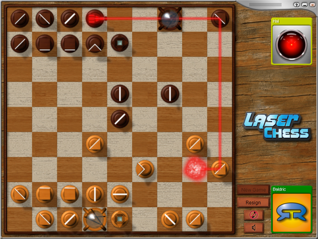

# TG-LaserChess
TrayGames Laser Chess Decompilation



`LaserChess.sln` builds the decompiled game client, a local server that replaces the TrayGames game server, and a bot opponent. Libraries the client uses are in `OriginalDLLs/`.

## Requirements

- Windows, .NET Framework 3.5
- DirectX End-User Runtime (June 2010)
- Visual Studio or MSBuild, to build

## Building

To build, open `LaserChess.sln` and build the Release configuration, or run:

```
msbuild LaserChess.sln /p:Configuration=Release /p:Platform=x86
```

Output is `bin/Release/`, with game files copied next to the executables.

## Playing

To play against the bot, right-click `Playtest.ps1` and select Run with PowerShell, or run:

```
powershell -ExecutionPolicy Bypass -File Playtest.ps1
```

It starts the server, one game window, and the bot as player 2.

To play two players on one PC:

1. Run the server:

   ```
   LaserChessServer.exe --name1 Ashley --name2 Andrew
   ```

2. Start `LaserChess.exe` twice with no arguments. First window to connect is player 1, who moves first.

`LaserChess.exe` started with no arguments connects to the local server instead of the TrayGames lobby.

When one player closes their window, the other window shows the quit screen. To play again, close it and start new game windows. To stop the server, press **Ctrl+C**.

### Server options

| Option | Description |
| --- | --- |
| `--bot` | Start `LaserChessBot.exe` as player 2 when player 1 joins |
| `--name1 NAME` | Player 1 name. Default is `Player 1` |
| `--name2 NAME` | Player 2 name. Default is `Player 2` |
| `--verbose` | Log every message sent and received |

Moves are checked with `LaserChess.Logic.dll`. Chat, draw offers, resigning, and new games work as in the original.

### Bot

`LaserChessBot.exe` connects to the server like a game window and takes no arguments. It plays the move that captures the most material one move ahead, declines draw offers, accepts new games, and exits when its opponent leaves.
